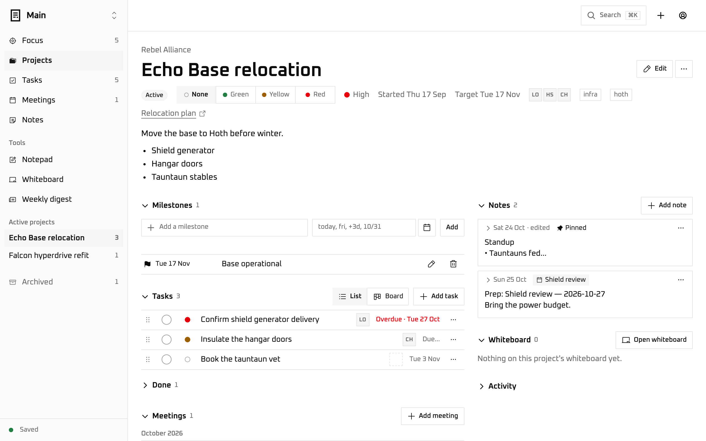
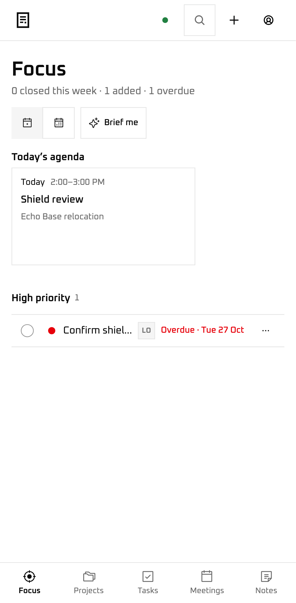

<p align="center">
  
</p>

# Datapad

A private project tracker for one engineering leader.

Projects, tasks, notes, meetings, milestones, whiteboards and people in one
place, with cross-project views, search and summaries that run on your own
device. Only you can open it, your data stays in your own Cloudflare
account, and nothing is ever wiped. Built for daily use on a laptop and a
phone.

Runs entirely on Cloudflare: Cloudflare Access signs you in, one Worker
serves the app and checks your sign-in again on every request, and one
SQLite-backed Durable Object per email holds your data, pushes live updates
over WebSockets, and backs itself up to R2 every night.

<p align="center">
  
  &nbsp;
  
</p>

<p align="center"><sub>A project page on a laptop and Focus on a phone, with fictional data.</sub></p>

## Features

- **Projects.** Name, org, status (active, paused, done), priority,
  start and target dates, members, tags, links, a Markdown description,
  a health flag (green, yellow, red) and an activity log. A project page
  holds its milestones, tasks, meetings, notes and whiteboard. Archive
  when done; start a new one from a template.
- **Tasks.** Add from the top bar's + or `n`, a circular checkbox to
  close with Undo, priority, due date (type `fri`, `+3d`,
  `10/31`), assignee, tags, links, Markdown details and dated running
  notes. Mark a task blocked on someone. Select several in the table to
  close, move or assign at once. Reorder by drag, keyboard or touch. Each
  task has a page of its own from Tasks and a side panel everywhere else.
- **Notes.** Markdown with three heading levels, lists, clickable
  checklists, code, quotes and links; `@` mentions of people; a `/`
  command menu and formatting keys in the composer; pinned notes; select
  text to make a task from it; note templates for the 1:1s and status
  updates you write the same way every time.
- **Meetings.** Date, times, project, attendees and a link. Topics are the
  agenda: tick them off, note an outcome, reorder; a new meeting in a
  series (same title, project and people) offers to carry the uncovered
  ones forward. Action items are real tasks that say which meeting they
  came from. Add as many notes as you like, before, during or after.
- **Milestones.** Dated marks on a project, shown on the project page, the
  Projects timeline and the Focus agenda.
- **Focus.** A briefing of what needs you: the week's movement; Since
  yesterday, what happened on the last working day (Friday through Sunday
  on a Monday); today's or the week's meetings and milestones with where
  each meeting's prep stands, blocked tasks by who they wait on, projects
  off health or near their target, open action items, and what is overdue
  or due today. With summaries on, **Brief me** has the on-device model
  turn it into a few sentences about yesterday and today.
- **Layouts.** Projects as cards, a table or a timeline; Tasks as a list,
  a table, a board or a timeline, grouped by project, due, assignee or
  priority; Meetings as a list, a month calendar or a timeline; Notes as
  a list or a grid. Every page remembers its layout, sort, filters and
  open sections, saved with your data so every device opens it the same
  way. Settings → Navigation picks which sections and tools the rail and
  the phone's tab bar show, and in what order.
- **Tools.** Under their own heading in the rail: the Notepad, the
  Whiteboard and the Weekly digest, each shown or hidden, ordered and put
  on the phone's tab bar as you like (otherwise they are in the account
  menu).
- **Notepad.** One running note for the space, saved as you type, for
  whatever you need to jot down before it has a home.
- **Whiteboards.** A freeform canvas for each project and one for the
  space: sticky notes, text, rectangles, arrows and freehand ink in five
  colors, undo and redo, zoom and pan, download as PNG or SVG. Live on
  every device like everything else.
- **Search.** `⌘K` finds any project, task, note, meeting, org, person or
  whiteboard item and runs actions.
- **People and orgs.** Everyone you assign, add to projects and mention,
  each with their projects, open tasks and mentions for a quick check
  before a 1:1; the clients, teams, vendors and partners your projects
  belong to. Both are added inline from any form.
- **Spaces.** One or more complete, separate Datapads under one sign-in
  (work and personal, say). Switch from the rail, the account menu or
  `⌘K`; move a project between them with everything it owns.
- **Weekly digest.** What happened in each project over a week, from the
  tasks, notes, meetings and activity logs; copy as Markdown or keep it
  as a note.
- **Summaries.** Summarize a project, task, meeting, note or digest, or
  ask Focus to Brief me, with a small language model
  ([WebLLM](https://github.com/mlc-ai/web-llm); Qwen3 1.7B by default, 4B
  and 8B selectable) that runs in your browser on your GPU. Nothing about your data leaves the device. Opt-in: the
  model downloads from Hugging Face only after you agree, and stays
  cached in that browser. Needs WebGPU.
- **Works offline.** The last snapshot paints at once; changes made
  offline, or in a tab closed before they were saved, wait on the device
  and send when you are back, even after a reload. The status says Saved,
  Saving… or Offline with how many changes are waiting.
- **Export, import, backups.** One JSON file per space, yours to keep;
  import merges by id so repeating it is safe. Every night each space is
  written to your own R2 bucket, 30 kept, with download and restore in
  Settings → Data.
- **Phone first.** Every view is built and tested at phone width: a
  bottom tab bar, 44px touch targets, full-screen panels, tables that
  collapse to rows, nothing hover-only. Installs to the home screen.
- **Themes.** System, Light and Dark; a Motion switch, with
  `prefers-reduced-motion` as a hard override; a 12-hour or 24-hour
  clock.
- **In-app help** at `/help`: the views, the common path, every keyboard
  shortcut, `/` command, formatting key and layout, generated from the
  app's own lists so they cannot drift.

## Privacy and data

- **Only you can open it.** Cloudflare Access stands in front of the
  hostname with a policy that allows your email. The Worker verifies the
  Access token again on every request, assets included; without a valid
  sign-in nothing is served, not even the page shell, and a hostname the
  Access application does not cover fails closed.
- **Your data lives in your account.** One Durable Object, named by your
  verified email and reachable no other way, holds every space. Nightly
  backups go to an R2 bucket in the same account. Nothing is ever deleted
  on a timer: the only way to erase a space is a deliberate, single-use
  token you ask for yourself.
- **Nothing leaves.** No third-party service, no analytics, no API key.
  Summaries run on-device; the only download is the model's weights,
  after you agree, with no referrer and none of your data. The content
  security policy allows no other origin.
- **More than one person** in the Access policy means more than one
  Datapad: each email gets its own object, empty at first, and nothing is
  shared.
- **The browser stores** the last snapshot and unsaved changes (IndexedDB
  and `localStorage`, keys prefixed `datapad:`), which space is open, the
  theme, motion and clock preferences, drafts you have not saved, each
  whiteboard's viewport and, if you use Summaries, the model weights in
  Cache Storage and the day's brief. Clearing site data removes them.
- **Logs.** Access logs record your email and sign-ins, by design. The
  Worker logs errors with the request path only, never document content.
- **This repository is public** and contains no data; the fixtures are
  fictional.

Limits: 12 spaces; titles 200 characters, bodies and descriptions 20,000;
50 milestones per project, 50 topics per meeting, 100 members or
attendees; 2,000 items per whiteboard; 150 activity entries per log; 16 MiB
per import; 20 ops per second per connection; 30 backups kept per space;
60 MCP tool calls a minute per connection.

## Connect Claude

Datapad is an MCP server at `/mcp`: `claude mcp add --transport http
datapad https://<host>/mcp`, or a custom connector in claude.ai or Claude
Desktop. You sign in through Access and approve the client on a consent
page. Claude can then read everything the app shows: the overview, Focus,
what happened since the last working day, projects, tasks, notes,
meetings, people, orgs, the digest and search. See
[docs/mcp.md](docs/mcp.md).

## Run it yourself

See **[docs/self-hosting.md](docs/self-hosting.md)**. Short version: a
Cloudflare account with Zero Trust (the free plans cover it), make the
config in `wrangler.jsonc` yours, `bun install`, `npx wrangler login`,
create the R2 bucket, `npm run deploy`, then put Access in front and paste
its two public values into the config. About 20 minutes. No secrets, no
paid plan.

Also: [docs/architecture.md](docs/architecture.md) for how it fits
together, [docs/data.md](docs/data.md) for what is stored where, the
export format, backups and deleting, [docs/security.md](docs/security.md)
for the threat model and headers, [docs/design.md](docs/design.md) for
tokens, density and copy, [docs/SPEC.md](docs/SPEC.md) for what the
product does and [docs/PLAN.md](docs/PLAN.md) for how it was built.
[CHANGELOG.md](CHANGELOG.md) lists every release; [AGENTS.md](AGENTS.md)
is the guide to working in this repository.

## Stack

React 19 + TypeScript + Vite, Tailwind CSS v4, stock shadcn (base-lyra on
Base UI), Oxanium + JetBrains Mono, Phosphor icons, `cmdk`, zod, Biome.
Cloudflare Workers + Durable Objects (SQLite storage, WebSocket
hibernation) and R2 through `@cloudflare/vite-plugin`. Tests with Vitest
inside workerd via `@cloudflare/vitest-plugin`; Playwright + axe at desktop
and phone width. No animation library for the app's own motion: View
Transitions, the Web Animations API, `@starting-style` and CSS `linear()`
springs. (The stock shadcn overlays ship with `tw-animate-css` for their
open and close transitions; nothing else uses it.)

## Commands

```bash
bun install          # npm's resolver currently trips on Vitest 4.1 peers
cp .dev.vars.example .dev.vars   # once: who you are while developing
npm run dev          # http://localhost:5173 with the Worker and DO running locally
npm test             # type-gen + vitest in workerd (reducer, DO, Access, routes, headers)
npm run e2e          # playwright + axe, desktop and phone: every view, keyboard, offline, a11y
npm run check        # biome
npm run build        # types + tsc + vite build (client + worker)
npm run deploy       # build + wrangler deploy
```

Change `DEV_ACCESS_EMAIL` in `.dev.vars` to get a fresh, empty Datapad;
local data lives in `.wrangler/state`.

## License

MIT.
