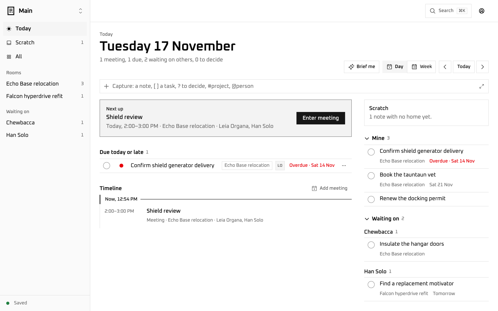
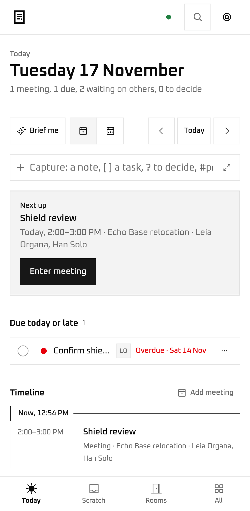
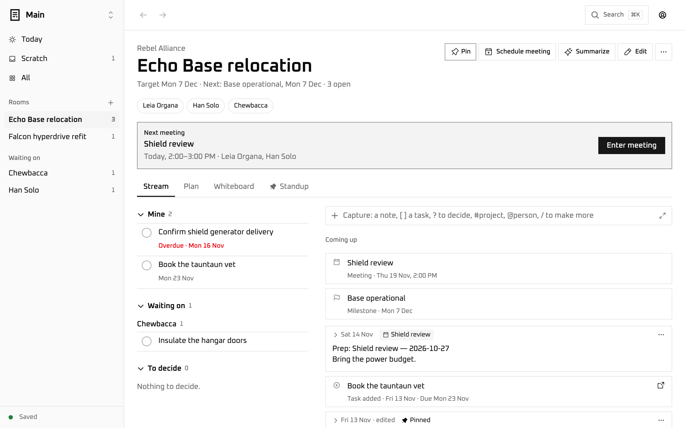
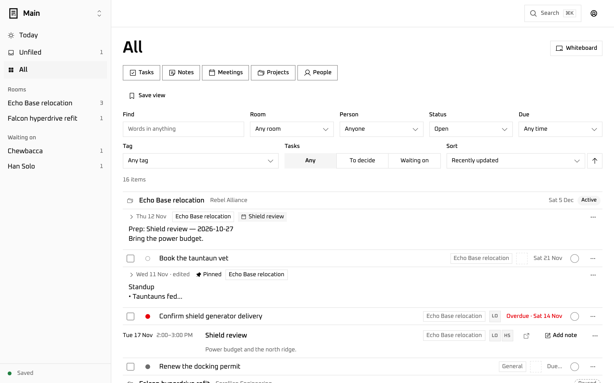
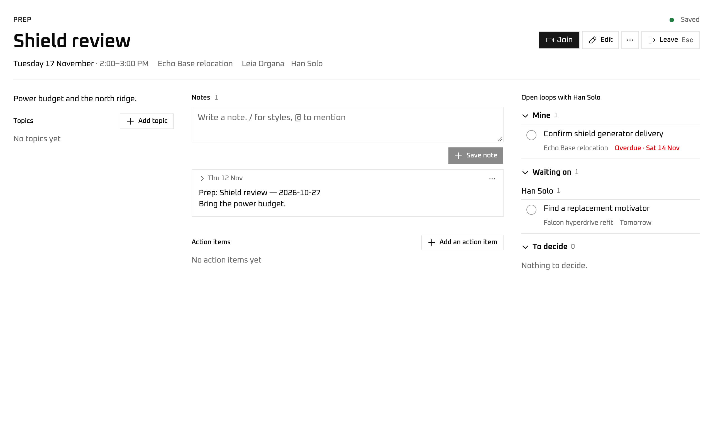

<p align="center">
  
</p>

# Datapad

A private project tracker for one engineering leader.

Your day, your projects and your people, in one place: a timeline of
the day with the open loops beside it, a room for every project and every
person, one list of everything, and one line to capture anything into.
Search and summaries run on your own device. Only you can open it, your
data stays in your own Cloudflare account, and nothing is ever wiped.
Built for daily use on a laptop and a phone.

Runs entirely on Cloudflare: Cloudflare Access signs you in, one Worker
serves the app and checks your sign-in again on every request, and one
SQLite-backed Durable Object per email holds your data, pushes live updates
over WebSockets, and backs itself up to R2 every night.

<p align="center">
  
  &nbsp;
  
</p>

<p align="center">
  
  &nbsp;
  
</p>

<p align="center">
  
</p>

<p align="center"><sub>Today, a project room, All and meeting mode, with fictional data.</sub></p>

## Features

- **Today.** The home page, one day at a time. A line that counts the
  day ("2 meetings, 3 due, 4 waiting on others, 1 to decide"), **Next
  up** with Enter meeting, what is due, and a timeline of the day's
  meetings, tasks and notes with a Now line. Beside it, the open loops in
  three lanes: **Mine**, **Waiting on** (by person) and **To decide**.
  Step back to the last working day for the recap of what happened, zoom
  out to the week (with its digest, Copy as Markdown), and with
  summaries on, **Brief me**.
- **The capture line.** One input at the top of Today and every room.
  Type a line and chips say what it becomes and where it goes: a note,
  a task (`[ ]`, `todo` or a date), something to decide (`?`) or
  something you are waiting on (`waiting on @Name`). `#project` files
  it, `@Name` mentions or assigns. `/` at the start makes something
  else: `/meeting` (with a day and time), `/milestone`, `/project` or
  `/person`. Enter saves, with Undo.
- **Scratch.** The notes with no home yet, as one running pad: write at
  the top, then file each to a project, make a task of it or mark it to
  decide.
- **Rooms.** A page for each project and each person. A project room has
  a state line (health, target, next milestone, open loops), the next
  meeting, and three tabs: **Stream** (the lanes beside one stream of
  everything attached), **Plan** (description, details, milestones,
  members, links, activity) and **Whiteboard**. A person room is the
  1:1 prep: **You owe**, **They owe you** and **To discuss** beside
  their stream. Pin rooms to the rail, or a project seen through one
  person. Pin a note and it sits in its room's tab row, one click from
  any tab; a person room shows the pinned notes that mention them. On a
  phone the Rooms tab lists the same rooms.
- **All.** Every task, note, meeting, project and person in one list.
  Pick kinds, find, filter and sort; tasks show as a list, a table or a
  board, meetings as a list or a calendar, projects as a list, cards or a
  timeline. The **Rooms** chip shows every project room under its org
  and every person, to open or pin. Save a view as a chip, pin it to
  the rail, and select tasks to complete, move, assign or date them at
  once, with Undo.
- **Meeting mode.** A meeting opens full screen: Prep, Live or Debrief,
  the agenda and topics (with Carry forward from the last one in the
  series), the note composer always open, the action items, and the open
  loops of the person or the project.
- **Tasks.** A circular checkbox to close with Undo, priority, due date
  (type `fri`, `+3d`, `10/31`), assignee, tags, links, Markdown details,
  dated running notes, blocked on someone, or to decide. Each opens in a
  side panel.
- **Notes.** Formatted as you write, with no Markdown on screen, and
  stored as plain Markdown: three heading levels, lists, clickable
  checklists, code, quotes and links; `@` mentions of people; a `/`
  command menu and formatting keys in the composer, whose `/task`,
  `/meeting`, `/person` and other create commands turn the line you are
  on into one; select text to make a
  task from it; note templates for the 1:1s and status updates you write
  the same way every time.
- **Whiteboards.** A freeform canvas in each project room and one for the
  space: sticky notes, text, rectangles, arrows and freehand ink in five
  colors, undo and redo, zoom and pan, download as PNG or SVG. Live on
  every device like everything else.
- **Search.** `⌘K` finds any project, task, note, meeting, org, person or
  whiteboard item, and adds a task, note, meeting or project.
- **People and orgs.** Everyone you assign, add to projects and mention;
  the clients, teams, vendors and partners your projects belong to. Both
  are added inline from any form, and the capture line adds a new name.
- **Spaces.** One or more complete, separate Datapads under one sign-in
  (work and personal, say). Switch from the rail, the account menu or
  `⌘K`; move a project between them with everything it owns.
- **Summaries.** Summarize a room, a meeting or a task, or ask Today to
  Brief me, with a small language model
  ([WebLLM](https://github.com/mlc-ai/web-llm); Qwen3 1.7B by default, 4B
  and 8B selectable) that runs in your browser on your GPU. Nothing about
  your data leaves the device. Opt-in: the model downloads from Hugging
  Face only after you agree, and stays cached in that browser. Needs
  WebGPU.
- **Works offline.** The last snapshot paints at once; changes made
  offline, or in a tab closed before they were saved, wait on the device
  and send when you are back, even after a reload. The status says Saved,
  Saving… or Offline with how many changes are waiting.
- **Export, import, backups.** One JSON file per space, yours to keep;
  import merges by id so repeating it is safe. Every night each space is
  written to your own R2 bucket, 30 kept, with download and restore in
  Settings → Data.
- **Phone first.** Every view is built and tested at phone width: a
  bottom tab bar (Today, Scratch, Rooms, All), 44px touch targets,
  full-screen panels, tables that collapse to rows, nothing hover-only.
  Installs to the home screen.
- **Themes.** System, Light and Dark; a Motion switch, with
  `prefers-reduced-motion` as a hard override; a 12-hour or 24-hour
  clock.
- **Settings** for Today, the rooms, the capture line and All, each
  with Reset to defaults, and every default in one place.
- **In-app help** at `/help`: how Datapad works, every keyboard
  shortcut, `/` command, formatting key and layout, generated from the
  app's own lists so they cannot drift.

## Privacy and data

- **Only you can open it.** Cloudflare Access stands in front of the
  hostname with a policy that allows your email. The Worker verifies the
  Access token again on every request, assets included; without a valid
  sign-in nothing is served, not even the page shell, and a hostname the
  Access application does not cover fails closed.
- **Your data lives in your account.** One Durable Object, named by your
  verified email and reachable no other way, holds every space. Nightly
  backups go to an R2 bucket in the same account. Nothing is ever deleted
  on a timer: the only way to erase a space is a deliberate, single-use
  token you ask for yourself.
- **Nothing leaves.** No third-party service, no analytics, no API key.
  Summaries run on-device; the only download is the model's weights,
  after you agree, with no referrer and none of your data. The content
  security policy allows no other origin.
- **More than one person** in the Access policy means more than one
  Datapad: each email gets its own object, empty at first, and nothing is
  shared.
- **The browser stores** the last snapshot and unsaved changes (IndexedDB
  and `localStorage`, keys prefixed `datapad:`), which space is open, the
  theme, motion and clock preferences, drafts you have not saved, each
  whiteboard's viewport and, if you use Summaries, the model weights in
  Cache Storage and the day's brief. Clearing site data removes them.
- **Logs.** Access logs record your email and sign-ins, by design. The
  Worker logs errors with the request path only, never document content.
- **This repository is public** and contains no data; the fixtures are
  fictional.

Limits: 12 spaces; titles 200 characters, bodies and descriptions 20,000;
50 milestones per project, 50 topics per meeting, 100
members or attendees; 2,000 items per whiteboard; 150 activity entries per
log; 16 MiB per import; 20 ops per second per connection; 30 backups kept
per space; 60 MCP tool calls a minute per connection.

## Connect Claude

Datapad is an MCP server at `/mcp`: `claude mcp add --transport http
datapad https://<host>/mcp`, or a custom connector in claude.ai or Claude
Desktop. You sign in through Access and approve the client on a consent
page. Claude can then read everything the app shows: Today and its open
loops, Scratch, a project's or a person's room, what happened since the
last working day, projects, tasks, notes, meetings, people, orgs, the
week's digest and search. With write access it can capture tasks and
notes, mark a task to decide and file a note. See
[docs/mcp.md](docs/mcp.md).

## Run it yourself

See **[docs/self-hosting.md](docs/self-hosting.md)**. Short version: a
Cloudflare account with Zero Trust (the free plans cover it), make the
config in `wrangler.jsonc` yours, `bun install`, `npx wrangler login`,
create the R2 bucket, `npm run deploy`, then put Access in front and paste
its two public values into the config. About 20 minutes. No secrets, no
paid plan.

Also: [docs/architecture.md](docs/architecture.md) for how it fits
together, [docs/data.md](docs/data.md) for what is stored where, the
export format, backups and deleting, [docs/security.md](docs/security.md)
for the threat model and headers, [docs/design.md](docs/design.md) for
tokens, density and copy, [docs/SPEC.md](docs/SPEC.md) for what the
product does and [docs/PLAN.md](docs/PLAN.md) for how it was built.
[CHANGELOG.md](CHANGELOG.md) lists every release; [AGENTS.md](AGENTS.md)
is the guide to working in this repository.

## Stack

React 19 + TypeScript + Vite, Tailwind CSS v4, [Beskar](https://github.com/jbouder/beskar) (a shadcn base-lyra registry on
Base UI), Oxanium + JetBrains Mono, Phosphor icons, `cmdk`, zod, Biome.
Cloudflare Workers + Durable Objects (SQLite storage, WebSocket
hibernation) and R2 through `@cloudflare/vite-plugin`. Tests with Vitest
inside workerd via `@cloudflare/vitest-plugin`; Playwright + axe at desktop
and phone width. No animation library for the app's own motion: View
Transitions, the Web Animations API, `@starting-style` and CSS `linear()`
springs. (The stock shadcn overlays ship with `tw-animate-css` for their
open and close transitions; nothing else uses it.)

## Commands

```bash
bun install          # npm's resolver currently trips on Vitest 4.1 peers
cp .dev.vars.example .dev.vars   # once: who you are while developing
npm run dev          # http://localhost:5173 with the Worker and DO running locally
npm test             # type-gen + vitest in workerd (reducer, DO, Access, routes, headers)
npm run e2e          # playwright + axe, desktop and phone: every view, keyboard, offline, a11y
npm run check        # biome
npm run build        # types + tsc + vite build (client + worker)
npm run deploy       # build + wrangler deploy
```

Change `DEV_ACCESS_EMAIL` in `.dev.vars` to get a fresh, empty Datapad;
local data lives in `.wrangler/state`.

## License

MIT.
